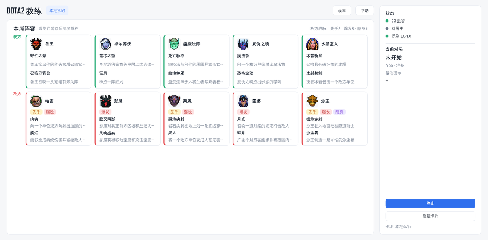
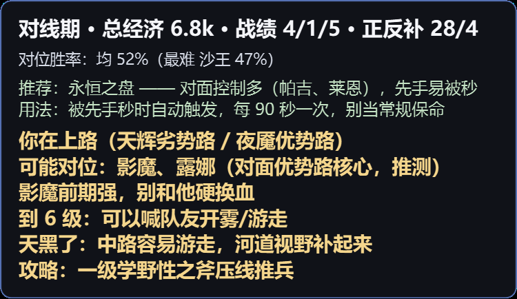
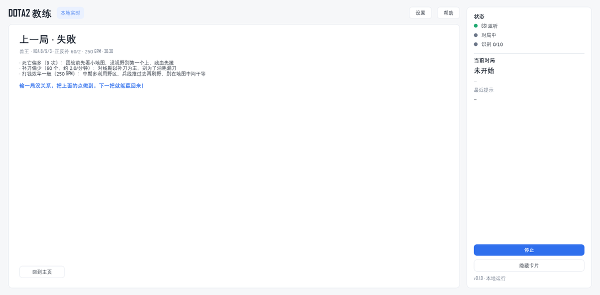

<!-- Язык / Language -->
[简体中文](README.zh-CN.md) · [繁體中文](README.zh-TW.md) · [English](README.en.md) · [Français](README.fr.md) · [Русский](README.ru.md) · [Deutsch](README.de.md) · [Português](README.pt.md) · [Español](README.es.md) · [Türkçe](README.tr.md)

# DOTA2 GETTING STARTED Coach

Тренер Dota 2 в реальном времени, внешний оверлей. Работает только через **официальный GSI Valve** и **снимки собственного экрана**:
без чтения памяти, без инъекций, без эмуляции клавиш, без модов.

<p>
  <a href="https://github.com/OWNER/REPO/actions/workflows/tests.yml"></a>
  <a href="LICENSE"></a>
  
  
</p>

## Скриншоты

<p align="center">
  
  
  
</p>

## Для кого

**Для тех, кто только начал играть в Dota 2**: не знаете всех героев, не понимаете, где стоять на линии, собираете билды по чужим гайдам и теряетесь в драках.

Осознанные компромиссы:

- **Не играет за вас**: одна короткая фраза, когда нужно, а не стена цифр;
- **Не нужен Dota Plus**: герои распознаются по верхней панели, обычный аккаунт подходит;
- **Без чтения памяти**: официальный GSI + снимки вашего экрана;
- **9 языков интерфейса и озвучки**: интерфейс, подсказки и речь переключаются вместе;
- **Разбор после каждой игры**: 1–3 исправления, которые можно применить сразу.

## Что умеет

- Читает GSI: ваш герой/уровень/HP/мана/способности/предметы/золото/KDA, время игры, счёт;
- **Снимает экран стратегии** и распознаёт все 10 героев по верхней панели (без Dota Plus); 10/10 на снимке 2560×1600;
- Пишет **имена под портретами** верхней панели (союзники зелёным, враги красным, клики проходят сквозь);
- Полупрозрачная **карточка поверх окон**: фаза и таймер, составы, следующий предмет, таймеры рун;
- **Тренер линии**: определяет вашу линию, даёт позиционирование и порог HP по угрозам (инициация/бурст/пуш/невидимость), плюс вард на 4-й минуте, ночь на 5-й, роум на 6-м уровне и предупреждение о ластхитах;
- **Звук + озвучка на 9 языках**: руны, линия, предметы, использование предметов и драки озвучиваются; синтез через edge-tts онлайн, поэтому работает даже при сломанном системном движке; **голосовой пакет следует языку интерфейса**;
- **Библиотека гайдов (Bilibili)**: периодический сбор гайдов того же патча (заголовок/комментарии/даньмаку, опциональная расшифровка), LLM сжимает в одну строку; обновление раз в неделю с чисткой;
- **Три состояния интерфейса**: приветствие, подсказки в игре и разбор партии (статистика, 1–3 совета, одно поощрение), возврат через 30 с;
- **Тема**: заменяемый фон главного окна (Настройки → Тема);
- **Голосовые пакеты**: 13 встроенных голосов edge (5 китайских + по одному для zh-TW/en/fr/ru/de/pt/es/tr), плюс свой голос;
- **Предупреждения о драках**: с 10-й минуты следит за точками миникарты, сообщает об исчезновении врагов, сборе союзников и начале драки, подсказывает по вашей роли; положение и размер миникарты настраиваются;
- **F8** — показать/скрыть карточку, **F9** — прослушать голос; карточка не перехватывает мышь.

## Что нового

- **Девять языков**: 简体中文, 繁體中文, English, Français, Русский, Deutsch, Português, Español, Türkçe. Главное окно, настройки, справка, разбор, страница билда и голосовые пакеты следуют языку; главное окно переключается сразу, без перезапуска.
- **Озвучка на девяти языках**: напоминания о предметах (Pipe/Crimson Guard/Greaves/Mekansm/Glimmer/Lotus/Solar/Pavise, Midas/Arcane/Soul Ring/Wand/Bottle/Helm), расходники линии (Dust/Magic Stick/Stout Shield/Tango), руны и драки озвучиваются на текущем языке; китайские названия способностей больше не попадают в другие языки.
- **Страница билда**: генерируется на каждом языке в `data/ingame_guide.<lang>.html`.
- **Адаптивная миникарта**: находит миникарту в любом нижнем углу и подстраивается под размер; если не уверена — Настройки → Помощь → Миникарта, положение/размер/смещение X-Y; скан с 10-й минуты и повторный поиск после долгого отсутствия красных точек.
- **Чище озвучка**: текст нормализуется (`·`, `——`, `（）`, `7:00`, `6.8k`), воспроизведение по реальной длительности аудио.
- **Умнее разбор**: саппортам больше не пишут «мало ластхитов / низкий GPM»; приветствия и поощрения случайные.
- **Один предмет за раз**: карточка советует предмет, который купить сейчас, с причиной, применением и прокачкой, затем переходит к следующему.
- **Два exe**: `Dota2Coach.exe` — главное окно, `Dota2Coach-Card.exe` — только карточка; старые `*.old.exe` удаляются при запуске.

## Быстрый старт

```powershell
cd <папка проекта>

# 1) окружение и зависимости (нужен Python 3.12)
powershell -ExecutionPolicy Bypass -File .\scripts\setup.ps1

# 2) скопировать конфиг GSI в папку игры
powershell -ExecutionPolicy Bypass -File .\scripts\copy_gsi.ps1

# 3) скачать шаблоны и данные (один раз)
powershell -ExecutionPolicy Bypass -File .\scripts\fetch_hero_icons.ps1
.\.venv\Scripts\python.exe scripts\fetch_popularity.py
.\.venv\Scripts\python.exe scripts\build_item_table.py

# 3.5) опционально: онлайн-озвучка (одна зависимость на 9 языков)
.\.venv\Scripts\pip.exe install edge-tts -i https://pypi.tuna.tsinghua.edu.cn/simple

# 4) перезапустить Dota 2 и запустить тренера
powershell -ExecutionPolicy Bypass -File .\scripts\run.ps1
```

Подробная установка и решение проблем: [docs/install.md](docs/install.md) (на китайском).

## Язык и озвучка

Настройки → Язык: выберите один из девяти языков и сохраните; главное окно переключится сразу, без перезапуска. Голосовой пакет сменится на этот язык автоматически; свой голос остаётся.
Настройки → Голос: включение озвучки, скорость/громкость, «Прослушать голос». При ошибке — возврат к звуковому сигналу; журнал в `logs\voice.log`.

## Границы данных

| Данные | Источник | Примечание |
|---|---|---|
| Ваш герой/способности/предметы/золото | GSI | официально, в реальном времени |
| Таймер/счёт/башни | GSI | официально, в реальном времени |
| Составы | снимок экрана стратегии | GSI даёт только «вас» |
| Позиции врагов / драки | снимок миникарты | цветовая сегментация + кластеризация |
| Билды | популярность предметов OpenDota | оффлайн-кэш |
| Роли / винрейты | OpenDota heroStats | текущий патч |
| Советы гайдов | видео Bilibili + DeepSeek | гайды патча |
| Озвучка | edge-tts онлайн (опционально) | 9 языков, откат к сигналу |

**Красные линии**: без чтения памяти, без инъекций, без эмуляции ввода, без автоматизации.

## План

| Этап | Содержание | Статус |
|---|---|---|
| M0 | GSI, логи, скрипты установки | готово |
| M1 | распознавание составов + карточка | 10/10 по верхней панели |
| M2 | база знаний + советы на драфте | не начато |
| M3 | тренер линии | готово |
| M4 | советы по предметам | один предмет + причина/применение/прокачка |
| M5 | предупреждения о драках | миникарта + советы по роли (после 10 мин) |
| M6 | упаковка и документация | окно, настройки/справка, два exe |
| M7 | библиотека гайдов Bilibili | работает |

## Сборка и тесты

```powershell
powershell -ExecutionPolicy Bypass -File .\scripts\build.ps1
.\.venv\Scripts\python.exe -m unittest discover -s tests -t . -v
```

Результат: `dist\Dota2Coach\Dota2Coach.exe` (окно) и `dist\Dota2Coach-Card\Dota2Coach-Card.exe` (только карточка).

## Загрузка

- Портативная сборка (Windows x64): [Releases](https://github.com/OWNER/REPO/releases/latest) — распакуйте и запустите `Dota2Coach.exe`
- Из исходников: см. «Быстрый старт» выше

## Соответствие и отказ от ответственности

- Это не официальный продукт Valve и он не связан с Valve.
- Читает только официальный GSI и снимки вашего экрана; без чтения памяти, инъекций и эмуляции клавиш.
- Соблюдайте условия Steam и Dota 2; используйте на свой риск.

## Благодарности

[OpenDota](https://www.opendota.com/) · [Bilibili](https://www.bilibili.com/) · [edge-tts](https://github.com/rany2/edge-tts) · [faster-whisper](https://github.com/SYSTRAN/faster-whisper) · [PyQt6](https://www.riverbankcomputing.com/software/pyqt/)

## Подробнее

- Самая полная документация (структура, источники, git): [README.zh-CN.md](README.zh-CN.md).
- Данные и скрипты: [docs/data-sources.md](docs/data-sources.md).
